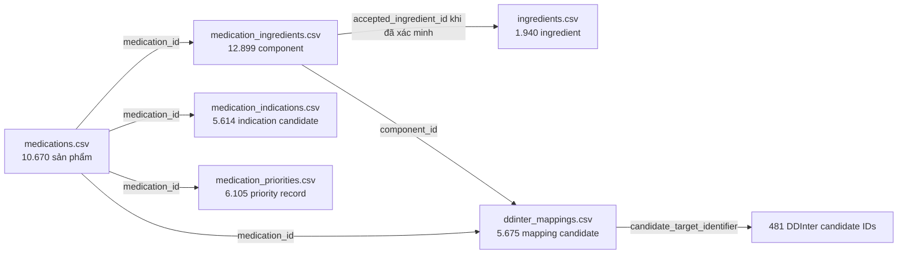

# Medication Safety Assistant - Tổng quan dữ liệu CSV hiện có

## 1. Mục đích tài liệu

Tài liệu này mô tả sáu file CSV hiện có trong thư mục [`data`](../../data). Nội dung tập trung vào:

- Mỗi file lưu loại dữ liệu gì.
- Một dòng trong file đại diện cho đối tượng nào.
- Ý nghĩa của các nhóm cột.
- Trạng thái xác minh và phạm vi sử dụng hiện tại.
- Quan hệ giữa các file.
- Những dữ liệu chưa có trong bộ CSV.

Tài liệu chưa mô tả cách chuyển dữ liệu sang physical database. Phần ánh xạ database cần được thiết kế sau khi thống nhất ý nghĩa và mức độ tin cậy của dữ liệu nguồn.

## 2. Tổng quan bộ dữ liệu

Bộ dữ liệu gồm 42.903 dòng trong sáu file:

- [`medications.csv`](../../data/medications.csv): 10.670 sản phẩm thuốc, 30 cột.
- [`ingredients.csv`](../../data/ingredients.csv): 1.940 danh tính hoạt chất cục bộ, 16 cột.
- [`medication_ingredients.csv`](../../data/medication_ingredients.csv): 12.899 thành phần của sản phẩm thuốc, 25 cột.
- [`medication_indications.csv`](../../data/medication_indications.csv): 5.614 phát biểu chỉ định ứng viên, 16 cột.
- [`medication_priorities.csv`](../../data/medication_priorities.csv): 6.105 bản ghi ưu tiên thu thập dữ liệu, 15 cột.
- [`ddinter_mappings.csv`](../../data/ddinter_mappings.csv): 5.675 ánh xạ ứng viên từ thành phần thuốc sang DDInter, 17 cột.

Các file này là dữ liệu đã qua một pipeline biến đổi. Chúng không phải các file nguồn thô ban đầu và cũng chưa phải toàn bộ dữ liệu đã được phê duyệt để sử dụng trong production.

## 3. Các cột nguồn gốc xuất hiện lặp lại

Phần lớn file có các cột sau:

- `id`: định danh của bản ghi sau biến đổi. ID có tiền tố thể hiện loại đối tượng, ví dụ `PC_`, `LI_`, `CC_`, `IA_`, `PR_` hoặc `DD3_`.
- `source_ref`: JSON chứa định danh bản ghi, SHA-256 và tên relation nguồn.
- `source_record_id`: định danh bản ghi bằng chứng hoặc bản ghi nguồn, thường có tiền tố `EV_`.
- `rule_version`: phiên bản quy tắc đã tạo hoặc biến đổi bản ghi, ví dụ `phase2.level2.coverage.v1.0.0`.
- `transformation_status`: kết quả cuối của bước biến đổi hiện tại.

`rule_version` là phiên bản logic biến đổi từng dòng. Nó không đồng nghĩa với phiên bản phát hành của toàn bộ dataset.

Nhiều cột chứa JSON dưới dạng text. Các giá trị này phải được parse như JSON thay vì tách bằng dấu phẩy hoặc xử lý như chuỗi thông thường.

## 4. `medications.csv`

### 4.1. Một dòng đại diện cho gì?

Một dòng đại diện cho một ứng viên sản phẩm thuốc đã đăng ký. Định danh của sản phẩm có dạng `PC_...`.

File có 10.670 dòng và không có `id` bị trùng.

### 4.2. Các nhóm cột

Nhóm định danh và nguồn gốc:

- `id`
- `source_ref`
- `source_record_id`
- `rule_version`
- `record_version`

Nhóm nhận diện sản phẩm:

- `brand_name`: tên thương mại.
- `registration_number_source`: số đăng ký đúng như nguồn công bố, có thể kèm trạng thái trong ngoặc.
- `registration_token`: phần số đăng ký đã được chuẩn hóa để so khớp.
- `manufacturer`: thông tin nhà sản xuất theo nguồn.

Nhóm dạng dùng và đóng gói:

- `dosage_form`: dạng bào chế nguyên bản.
- `dosage_form_key`: dạng bào chế đã chuẩn hóa để so sánh.
- `dosage_form_status`: mức độ nguồn hỗ trợ dạng bào chế.
- `route`: đường dùng chuẩn hóa nếu xác định được.
- `route_status`: trạng thái xác định đường dùng.
- `release_characteristic`: đặc tính giải phóng như bao tan trong ruột hoặc giải phóng kéo dài.
- `release_status`: trạng thái bằng chứng cho đặc tính giải phóng.
- `packaging`: quy cách đóng gói.

Nhóm trạng thái dữ liệu:

- `identity_state`: trạng thái danh tính sản phẩm.
- `integration_state`: trạng thái tích hợp vào tập dữ liệu.
- `composition_state`: trạng thái phân giải thành phần.
- `complete_active_composition_verified`: toàn bộ thành phần hoạt chất đã được xác minh trong phạm vi nguồn hay chưa.
- `level2_qualified`: sản phẩm có đạt tiêu chí Level 2 của pipeline hay không.
- `component_count`: số thành phần được pipeline ghi nhận.
- `observation_count`: số quan sát nguồn được hợp nhất.

Nhóm JSON và vấn đề cần xem xét:

- `identity_definition`: JSON mô tả danh tính sản phẩm, thành phần, bối cảnh sản xuất và đăng ký.
- `issues`: danh sách vấn đề được phát hiện.
- `retained_review_flags`: các cờ vẫn cần người review.
- `missing_identity_fields`: các trường danh tính còn thiếu.
- `verification_history`: lịch sử hoặc căn cứ xác minh.

### 4.3. Trạng thái hiện tại

- 8.741 sản phẩm có `level2_qualified=true`, tương đương 81,9%.
- 8.743 sản phẩm có `complete_active_composition_verified=true`.
- 1.929 sản phẩm chưa đạt Level 2.
- 9.313 sản phẩm có `route_status=NOT_EXPLICITLY_SUPPORTED`; không được tự suy luận rằng các sản phẩm này dùng đường uống.
- 10.428 sản phẩm không có đặc tính giải phóng được nguồn hỗ trợ rõ ràng.
- Có hai candidate `Viartril-S` sử dụng cùng `registration_token=539100008925`; cả hai đang có trạng thái danh tính mâu thuẫn.

## 5. `ingredients.csv`

### 5.1. Một dòng đại diện cho gì?

Một dòng đại diện cho một danh tính hoạt chất hoặc nhãn thành phần cục bộ. ID có dạng `LI_...`.

File có 1.940 dòng và không có `id` bị trùng.

### 5.2. Các nhóm cột

Nhóm tên và khóa so sánh:

- `source_name`: tên đúng như nguồn.
- `local_normalized_name`: tên đã chuẩn hóa trong phạm vi dữ liệu cục bộ.
- `local_comparison_key`: khóa dùng để so sánh tên.
- `accepted_normalized_name`: tên chuẩn hóa đã được chấp nhận.
- `accepted_normalized_identity_id`: ID danh tính được chấp nhận.

Nhóm phạm vi xác minh:

- `identity_kind`: loại danh tính; hiện tất cả đều là nhãn cục bộ do nguồn DAV khai báo.
- `identity_status`: trạng thái xác minh danh tính.
- `acceptance_scope`: phạm vi mà quyết định chấp nhận có hiệu lực.
- `clinical_identity_verified`: danh tính có được xác minh trong phạm vi pipeline hay chưa.
- `international_mapping_required`: cờ chính sách của lần biến đổi hiện tại.
- `unresolved_reason`: nguyên nhân chưa phân giải nếu có.

### 5.3. Trạng thái hiện tại

- 1.540 hoạt chất có `AUTO_VERIFIED_SOURCE_LOCAL_LABEL` và `clinical_identity_verified=true`.
- 400 hoạt chất mới chỉ có `SOURCE_ASSERTED_LOCAL_IDENTITY` và chưa được xác minh lâm sàng độc lập.
- Tất cả 1.940 dòng có `international_mapping_required=false`. Giá trị này không chứng minh rằng hoạt chất đã được ánh xạ sang RxNorm, DDInter hoặc một thuật ngữ quốc tế khác.

## 6. `medication_ingredients.csv`

### 6.1. Một dòng đại diện cho gì?

Một dòng đại diện cho một thành phần xuất hiện trong một sản phẩm thuốc. ID có dạng `CC_...`.

File có 12.899 dòng và không có `id` bị trùng. Tất cả 10.670 sản phẩm trong `medications.csv` có ít nhất một dòng thành phần.

### 6.2. Các nhóm cột

Nhóm liên kết sản phẩm và vị trí:

- `medication_id`: sản phẩm chứa thành phần.
- `parse_id`: lần hoặc kết quả parse đã tạo component.
- `ordinal`: thứ tự thành phần trong sản phẩm.

Nhóm văn bản nguồn:

- `original_name_candidate`: tên thành phần mà parser đề xuất.
- `ingredient_text_raw`: toàn bộ biểu thức thành phần và hàm lượng nguyên bản.
- `original_field`: trường nguồn chứa biểu thức.
- `original_span`: JSON mô tả vị trí ký tự trong trường nguồn.

Nhóm danh tính hoạt chất:

- `ingredient_id`: danh tính hoạt chất ứng viên; có thể trống khi parser chưa phân giải được.
- `accepted_ingredient_id`: danh tính hoạt chất đã được chấp nhận.
- `identity_state`: trạng thái nhận diện thành phần.
- `identity_verified`: danh tính thành phần đã được xác minh hay chưa.

Nhóm dạng hóa học và mô tả vật lý:

- `chemical_form_raw`: dạng muối, ester, hydrate hoặc dạng hóa học theo nguồn.
- `chemical_form_id`: định danh dạng hóa học nếu có.
- `equivalence_declaration_raw`: biểu thức tương đương theo nguồn.
- `physical_descriptors`: JSON chứa mô tả vật lý liên quan.

Nhóm hàm lượng:

- `strength_source_status`: trạng thái đọc biểu thức hàm lượng nguồn.
- `strength_transform_status`: loại kết quả sau biến đổi hàm lượng.
- `primary_strength_assertion_id`: định danh assertion hàm lượng chính.
- `strength_basis_verified`: cơ sở diễn giải hàm lượng đã được xác minh hay chưa.

### 6.3. Trạng thái hiện tại

- 10.242 component có `identity_verified=true`, tương đương 79,4%.
- 2.657 component chưa có `accepted_ingredient_id`, tương đương 20,6%.
- 662 component có `ingredient_id` trống do biểu thức nguồn chưa phân giải hoặc cần review. Đây là giá trị thiếu có chủ đích, không phải một ID trỏ tới ingredient không tồn tại.
- 12.062 component có `primary_strength_assertion_id`, tương đương 93,5%.
- 837 component chưa có primary strength assertion.
- Một sản phẩm có từ 1 đến 24 component, trung bình 1,21 component.

File này không chứa đầy đủ amount, unit, denominator amount và denominator unit của mọi strength assertion. Phần lớn thông tin chi tiết vẫn nằm trong `ingredient_text_raw` và các trạng thái biến đổi.

## 7. `medication_indications.csv`

### 7.1. Một dòng đại diện cho gì?

Một dòng đại diện cho một phát biểu ứng viên về việc một thuốc có liên quan tới một chỉ định hoặc một đoạn hướng dẫn điều trị. ID có dạng `IA_...`.

File có 5.614 dòng, liên quan tới 2.355 thuốc, tương đương 22,1% danh mục thuốc.

### 7.2. Các nhóm cột

Nhóm liên kết và loại phát biểu:

- `medication_id`: sản phẩm thuốc liên quan.
- `assertion_kind`: loại phát biểu, ví dụ ứng viên từ guideline hoặc ứng viên từ nhãn thuốc.
- `polarity`: khẳng định, phủ định hoặc chưa đánh giá.

Nhóm nội dung chỉ định:

- `text_raw`: đoạn văn nguồn được giữ nguyên.
- `condition_expression`: JSON biểu diễn điều kiện được trích xuất.
- `expression_state`: trạng thái phân tích biểu thức.
- `literal_operators`: JSON lưu các từ nối như “và”, “hoặc” cùng vị trí trong văn bản.

Nhóm review và phê duyệt:

- `status`: trạng thái ứng viên.
- `approval_status`: trạng thái kiểm tra độc lập.
- `approved_product_indication`: phát biểu đã được chấp nhận là chỉ định chính thức của đúng sản phẩm hay chưa.

Nhóm nguồn bằng chứng:

- `source_qualifications`: JSON chứa chủ đề lâm sàng, nhóm bệnh, guideline, URL, SHA-256, trang vật lý, đoạn trích và các thông tin review.

### 7.3. Trạng thái hiện tại

- 4.990 dòng là `RETAINED_GUIDELINE_ASSOCIATION_CANDIDATE`.
- 624 dòng là `LABEL_INDICATION_TEXT_CANDIDATE`.
- Tất cả 5.614 dòng có `polarity=UNASSESSED`.
- Tất cả có `expression_state=SOURCE_EXPRESSION_UNASSESSED`.
- Tất cả có `approved_product_indication=false`.
- Tất cả `condition_expression` có `normalized_nodes=[]` và `grouping_resolved=false`.
- Các dòng guideline tham chiếu tám guideline, tám URL và tám SHA-256 nguồn khác nhau.

Những dòng này là bằng chứng hoặc association candidate. Chúng chưa chứng minh rằng đoạn guideline là chỉ định được phê duyệt của đúng sản phẩm thuốc.

## 8. `medication_priorities.csv`

### 8.1. Một dòng đại diện cho gì?

Một dòng đại diện cho chính sách ưu tiên thu thập và review HDSD của một thuốc. ID có dạng `PR_...`.

File có 6.105 dòng và mỗi thuốc xuất hiện một lần trong file.

### 8.2. Các nhóm cột

- `medication_id`: sản phẩm thuốc được xếp ưu tiên.
- `purpose`: mục đích của chính sách ưu tiên.
- `collection_priority_tier`: mức ưu tiên thu thập.
- `source_clinical_priority`: mức ưu tiên được giữ từ nguồn trước đó.
- `selected_for_hdsd_collection`: thuốc có được chọn để thu thập HDSD hay không.
- `condition_groups`: các nhóm bệnh có liên quan trong chính sách nguồn.
- `selected_condition_groups`: nhóm bệnh thực sự được chọn.
- `policy_status`: trạng thái diễn giải chính sách.
- `policy_version`: phiên bản chính sách nếu xác định được.
- `clinical_recommendation`: dữ liệu này có phải khuyến nghị lâm sàng hay không.

### 8.3. Trạng thái hiện tại

- Tier 1: 1.637 thuốc.
- Tier 2: 149 thuốc.
- Tier 4: 4.319 thuốc.
- 1.786 thuốc có `selected_for_hdsd_collection=true`.
- 4.319 thuốc không được chọn trong lần thu thập này.
- Tất cả có `clinical_recommendation=false`.
- Tất cả có `policy_status=RETAINED_SOURCE_POLICY_NOT_REINTERPRETED`.
- Tất cả có `transformation_status=RETAINED_PRIORITY_POLICY_VERSION_UNRESOLVED`.

`collection_priority_tier` là ưu tiên thu thập dữ liệu, không phải mức ưu tiên kê đơn hoặc điều trị.

## 9. `ddinter_mappings.csv`

### 9.1. Một dòng đại diện cho gì?

Một dòng đại diện cho một mapping candidate giữa một component cục bộ và một DDInter drug entity. ID có dạng `DD3_...`.

File có 5.675 dòng, tương ứng 5.675 component khác nhau thuộc 5.271 thuốc.

### 9.2. Các nhóm cột

Nhóm liên kết nội bộ:

- `medication_id`: sản phẩm chứa component.
- `component_id`: component đang được ánh xạ.
- `mapping_set_id`: nhóm mapping, thường được dùng chung cho các component cùng bối cảnh sản phẩm.

Nhóm DDInter candidate:

- `candidate_target_identifier`: DDInter ID được đề xuất.
- `candidate_catalog_sha256`: SHA-256 của catalog DDInter đã dùng để tạo candidate.
- `source_name`: tên thuốc hoặc hoạt chất theo DDInter.

Nhóm quyết định:

- `status`: trạng thái candidate.
- `accepted`: candidate đã được chấp nhận hay chưa.
- `accepted_target_id`: target ID đã được reviewer chấp nhận.
- `operative`: mapping có được phép tham gia xử lý nghiệp vụ hay chưa.
- `unresolved_reason`: lý do candidate chưa đủ điều kiện sử dụng.

Nhóm bằng chứng:

- `retrieval_evidence`: JSON chứa truy vấn, vai trò của truy vấn, tên nguồn, URL, hash file, số dòng CSV và bằng chứng synonym nếu có.

### 9.3. Trạng thái hiện tại

- Có 481 `candidate_target_identifier` DDInter khác nhau.
- Tất cả 5.675 dòng có `status=SOURCE_SUPPORTED_LABEL_CANDIDATE`.
- Tất cả có `accepted=false`.
- Tất cả có `accepted_target_id` trống.
- Tất cả có `operative=false`.
- Tất cả có cùng lý do chưa giải quyết: tên trùng hoặc synonym nguồn chưa đủ để chứng minh dạng hóa học và thành phần của sản phẩm cục bộ áp dụng được cho DDInter entity.

File này chỉ chứa candidate ánh xạ danh tính. Nó không chứa cặp tương tác thuốc.

## 10. Quan hệ giữa các file

Các quan hệ đã kiểm tra:

- Tất cả `medication_id` trong component, indication, priority và DDInter mapping đều tồn tại trong `medications.csv`.
- Tất cả `component_id` trong `ddinter_mappings.csv` đều tồn tại trong `medication_ingredients.csv`.
- Mọi `accepted_ingredient_id` không trống đều tồn tại trong `ingredients.csv`.
- 662 component có `ingredient_id` trống do chưa phân giải; không có component trỏ tới một `ingredient_id` không trống nhưng không tồn tại.
- Không file nào có `id` bản ghi bị trùng.

## 11. Dữ liệu chưa có trong sáu CSV

Bộ CSV hiện tại không chứa:

- Cặp tương tác DDInter gồm thuốc A, thuốc B và mức độ tương tác.
- Mô tả cơ chế, xử trí hoặc tài liệu lâm sàng cho từng tương tác.
- Danh mục condition hoặc diagnosis đã chuẩn hóa.
- Liên kết đã được duyệt giữa indication và condition chuẩn.
- Toàn bộ thuộc tính cấu trúc của strength assertion như amount, unit và denominator.
- Quyết định của medical reviewer chấp nhận các DDInter mapping candidate.
- Chỉ định sản phẩm đã được phê duyệt độc lập.
- Dataset release đã được phát hành cho các module nghiệp vụ.
- Dữ liệu patient, HCP, OCR intake, safety assessment, reminder hoặc support ticket.

## 12. Quy tắc diễn giải dữ liệu

- `AUTO_VERIFIED` chỉ có hiệu lực trong phạm vi được ghi ở `acceptance_scope`; không phải khẳng định an toàn lâm sàng tổng quát.
- `accepted=false` hoặc `operative=false` nghĩa là mapping không được dùng để đưa ra kết quả tương tác.
- `clinical_recommendation=false` nghĩa là priority không phải khuyến nghị điều trị.
- `approved_product_indication=false` nghĩa là association không được hiển thị như chỉ định chính thức của sản phẩm.
- Không có bản ghi tương tác trong bộ dữ liệu hiện tại không được diễn giải thành “không có tương tác”.
- `international_mapping_required=false` không chứng minh rằng bản ghi đã có identifier quốc tế.
- ID như `PC_...`, `LI_...` và `CC_...` là source identifier dạng text, không phải UUID.

## 13. Kết luận

Sáu CSV tạo thành một catalog candidate gồm sản phẩm thuốc, thành phần, danh tính hoạt chất cục bộ, indication candidate, collection priority và DDInter mapping candidate. Phần sản phẩm và component có độ bao phủ cao, nhưng các nội dung có ảnh hưởng lâm sàng trực tiếp vẫn cần review. Đặc biệt, chưa có mapping DDInter nào được chấp nhận và chưa có indication nào được phê duyệt trong snapshot hiện tại.
