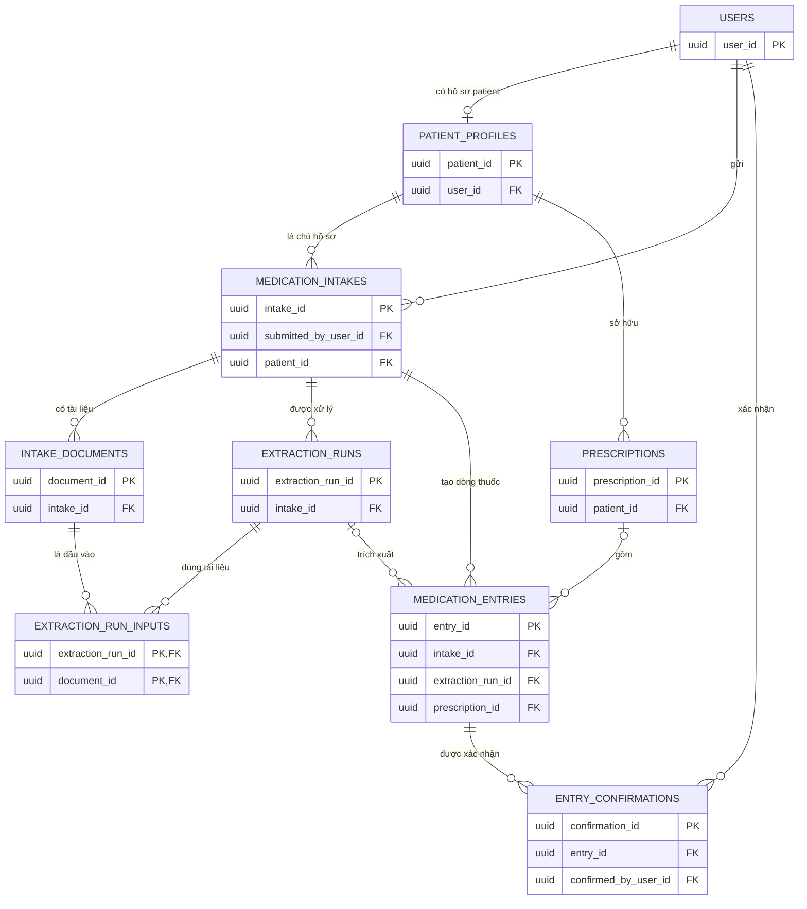
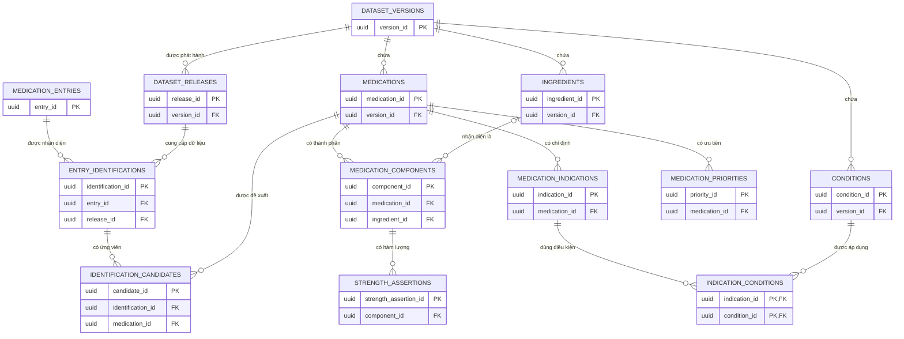
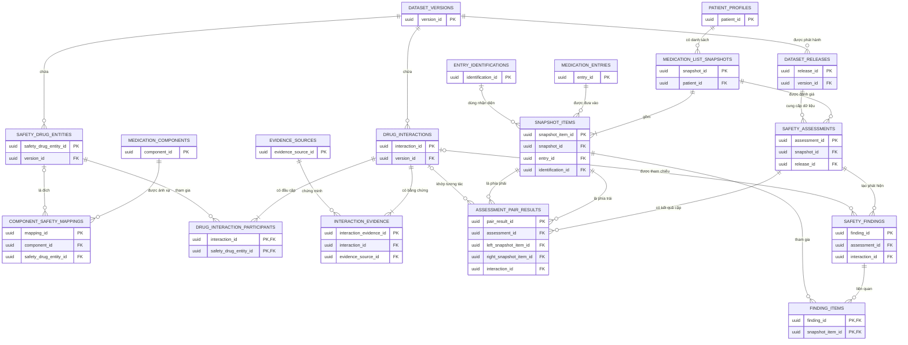
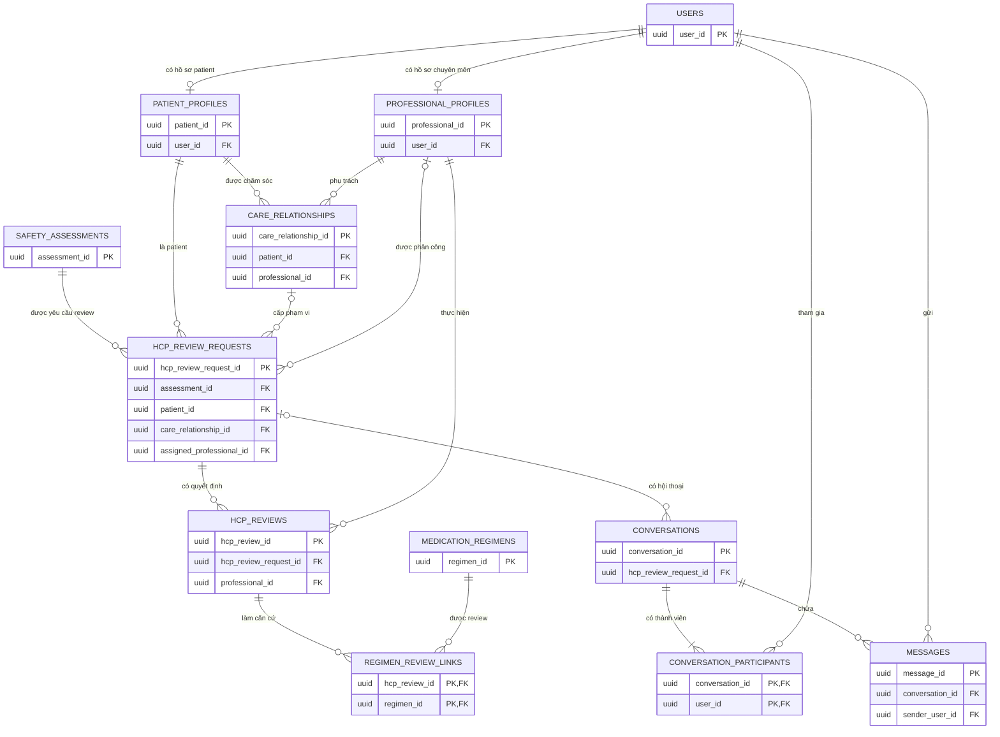
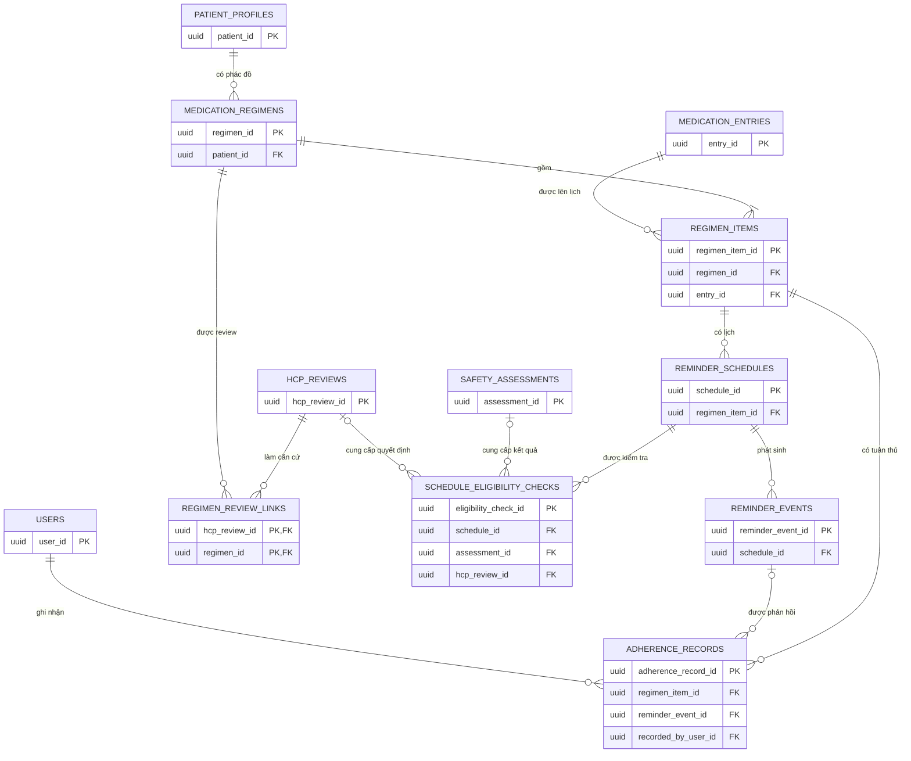

# Medication Safety Assistant - Module ERD Views

File này gom năm ERD view theo module vào một nơi để đọc và kiểm tra luồng liên module. Mỗi phần là một `erDiagram` độc lập; các bảng lặp lại giữa các phần vẫn là cùng một bảng trong database.

Nguồn chuẩn: [Unified SQL ERD](Medication-Safety-Assistant-Unified-SQL-ERD.md).

## Mục lục

1. [Module 1 - Medication Intake](#module-1---medication-intake)
2. [Module 2 - Medication Identification and Reference](#module-2---medication-identification-and-reference)
3. [Module 3 - Medication Safety Assessment](#module-3---medication-safety-assessment)
4. [Module 4 - HCP Review](#module-4---hcp-review)
5. [Module 5 - Medication Reminders](#module-5---medication-reminders)

## Module 1 - Medication Intake

Thu nhận ảnh, PDF, text, voice hoặc dữ liệu nhập tay; lưu từng lần trích xuất và xác nhận dòng thuốc.

Một intake có thể chưa tạo được dòng thuốc nếu quá trình trích xuất thất bại. Dòng nhập tay có thể không có `EXTRACTION_RUNS`; thuốc không xuất phát từ đơn có thể không có `PRESCRIPTIONS`.

---

## Module 2 - Medication Identification and Reference

Nhận diện dòng thuốc dựa trên một dataset release, giữ các ứng viên và lấy đầy đủ thành phần của sản phẩm.

Một sản phẩm có thể chưa có thành phần đã giải quyết hoàn chỉnh. `IDENTIFICATION_CANDIDATES` chỉ là ứng viên; trạng thái được chọn hoặc xác minh thuộc lần `ENTRY_IDENTIFICATIONS`.

---

## Module 3 - Medication Safety Assessment

Đóng băng danh sách thuốc, ánh xạ thành phần sang ID của nguồn an toàn, tra từng cặp và lưu mọi kết quả đánh giá.

Mỗi `DRUG_INTERACTIONS` phải có đúng hai participant khác nhau; SQL/logic giao dịch cần thực thi giới hạn này. “Không có bản ghi” phải được lưu trong `ASSESSMENT_PAIR_RESULTS`, không được chuyển thành kết luận an toàn.

---

## Module 4 - HCP Review

Tạo yêu cầu đánh giá từ một safety assessment, kiểm soát phạm vi truy cập, trao đổi với patient và lưu quyết định chuyên môn.

`HCP_REVIEWS` là quyết định cho trường hợp patient. Nó không thay thế `DATA_REVIEW_DECISIONS`, vốn dùng để duyệt dữ liệu tham chiếu chung.

---

## Module 5 - Medication Reminders

Quản lý phác đồ/lịch dùng thuốc, kiểm tra điều kiện kích hoạt, tạo từng lần nhắc và ghi nhận tuân thủ.

Một eligibility check có thể không cần HCP review, nhưng phải tham chiếu đúng phiên bản lịch và assessment phù hợp. Gửi reminder không đồng nghĩa patient đã dùng thuốc.

