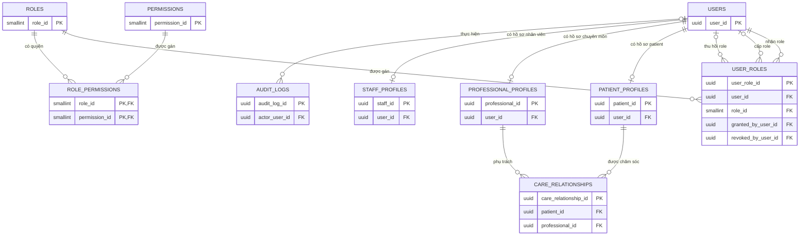
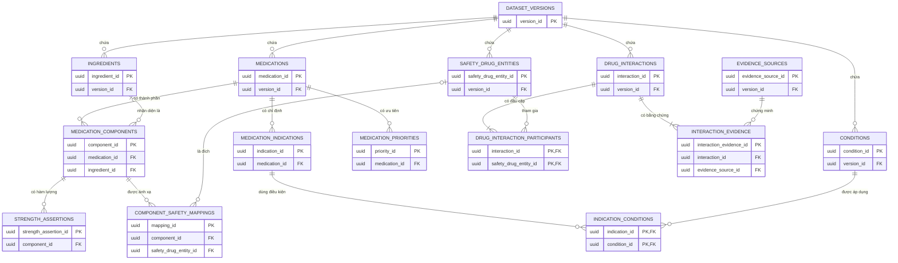
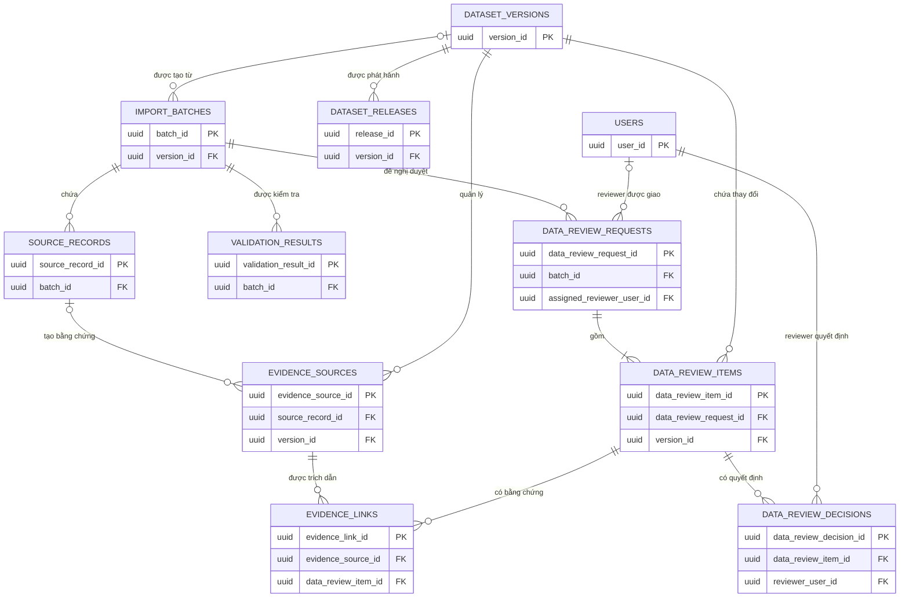
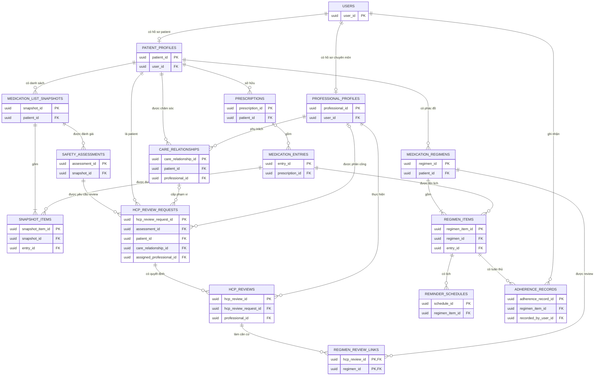
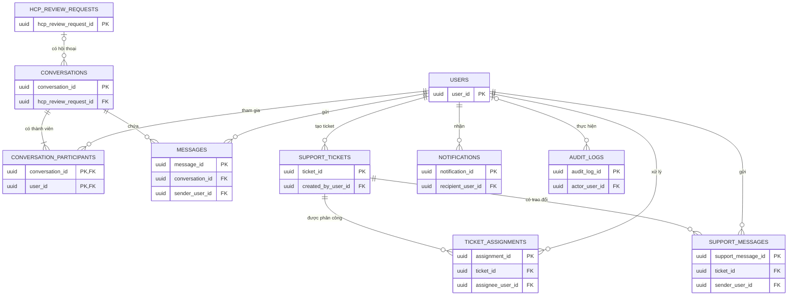

# Medication Safety Assistant - Shared Domain ERD Views

File này gom năm ERD view theo lĩnh vực dùng chung vào một nơi. Mỗi phần là một `erDiagram` độc lập; việc một bảng xuất hiện ở nhiều lĩnh vực chỉ thể hiện nhiều góc nhìn, không tạo thêm bảng vật lý.

Nguồn chuẩn: [Unified SQL ERD](Medication-Safety-Assistant-Unified-SQL-ERD.md).

## Mục lục

1. [Users and Access Control](#shared-domain---users-and-access-control)
2. [Medication and Safety Catalog](#shared-domain---medication-and-safety-catalog)
3. [Data Import, Review and Release](#shared-domain---data-import-review-and-release)
4. [Patient Medication Care](#shared-domain---patient-medication-care)
5. [Communication and Technical Support](#shared-domain---communication-and-technical-support)

## Shared Domain - Users and Access Control

Quản lý tài khoản, role, permission, hồ sơ theo loại người dùng và phạm vi chăm sóc. Đây là nơi thể hiện đầy đủ các role như `patient`, `hcp`, `admin`, `technical_support` và `medical_reviewer`; role là dữ liệu trong `ROLES`, không phải mỗi role một bảng.

`medical_reviewer` có thể đồng thời là HCP: người đó có một `USERS`, có thể có `PROFESSIONAL_PROFILES`, và nhận thêm role qua `USER_ROLES`. `STAFF_PROFILES` chỉ lưu hồ sơ nhân sự vận hành; quyền thực tế luôn được quyết định bởi role và permission.

---

## Shared Domain - Medication and Safety Catalog

Quản lý dữ liệu tham chiếu về thuốc, hoạt chất, chỉ định, ánh xạ sang thực thể an toàn và các cặp tương tác có bằng chứng.

`MEDICATION_COMPONENTS` nối sản phẩm thuốc với hoạt chất. `COMPONENT_SAFETY_MAPPINGS` nối hoạt chất đã chuẩn hóa với namespace dùng để tra tương tác. Mỗi `DRUG_INTERACTIONS` phải có đúng hai participant khác nhau; ràng buộc “đúng hai” sẽ được chốt ở physical design.

### Ghi chú đọc dữ liệu CSV hiện có

Phần này giải thích dữ liệu trong thư mục [`data`](../../data) tương ứng với các entity trong sơ đồ. Số liệu chi tiết và ý nghĩa từng cột được ghi tại [`Data-Overview.md`](../../data/Data-Overview.md).

#### Danh mục thuốc và hoạt chất

`medications.csv` → `MEDICATIONS`

- Mỗi dòng tạo một medication candidate với source ID dạng `PC_...`.
- Giữ tên thương mại, số đăng ký, nhà sản xuất, dạng bào chế, đường dùng, đóng gói và trạng thái xác minh.
- Mỗi bản ghi được gắn với `version_id` của dataset đang import.
- Source ID không phải UUID; khi sang physical design nên lưu trong một cột source identifier riêng hoặc đổi kiểu khóa cho phù hợp.

`ingredients.csv` → `INGREDIENTS`

- Mỗi dòng tạo một ingredient identity với source ID dạng `LI_...`.
- Giữ tên nguồn, tên chuẩn hóa, khóa so sánh, phạm vi chấp nhận và trạng thái xác minh.
- `international_mapping_required=false` không chứng minh rằng ingredient đã được ánh xạ sang DDInter hoặc thuật ngữ quốc tế khác.

`medication_ingredients.csv` → `MEDICATION_COMPONENTS`

- `medication_id` được resolve sang một bản ghi trong `MEDICATIONS`.
- Chỉ `accepted_ingredient_id` đã được xác minh mới nên trở thành FK nghiệp vụ chính thức tới `INGREDIENTS`.
- Khi `accepted_ingredient_id` trống, component vẫn được lưu nhưng liên kết ingredient chính thức để `NULL` và trạng thái phải là `REVIEW_REQUIRED`.
- Không được loại bỏ 662 component chưa phân giải; cần giữ nguyên `ingredient_text_raw`, source locator và vấn đề đã phát hiện để reviewer xử lý.

`medication_ingredients.csv` → `STRENGTH_ASSERTIONS`

- CSV hiện có `primary_strength_assertion_id`, biểu thức thành phần nguyên bản và trạng thái parse.
- Có thể lưu assertion ID, raw expression, source status và transform status.
- CSV chưa có đầy đủ amount, unit, denominator amount và denominator unit cho mọi assertion. Muốn chuẩn hóa chính xác cần thêm nguồn strength assertion chi tiết hoặc chạy pipeline parse và review riêng.
- Không được tự suy diễn giá trị số từ chuỗi phức tạp khi chưa xác định dạng hóa học và cơ sở tương đương.

`medication_priorities.csv` → `MEDICATION_PRIORITIES`

- Dữ liệu thể hiện ưu tiên thu thập và review HDSD.
- `collection_priority_tier` không phải mức ưu tiên kê đơn hoặc khuyến nghị điều trị.
- Tất cả bản ghi hiện có `clinical_recommendation=false`; physical design cần đặt tên thuộc tính đủ rõ để tránh diễn giải sai.

#### Chỉ định và condition

`medication_indications.csv` → `MEDICATION_INDICATIONS`

- Lưu nguyên văn phát biểu, nguồn bằng chứng, polarity, trạng thái expression và trạng thái approval.
- Tất cả bản ghi hiện tại phải được giữ ở trạng thái candidate hoặc pending review vì `approved_product_indication=false`.
- Những dòng lấy từ guideline chỉ chứng minh rằng thuốc hoặc hoạt chất xuất hiện trong đoạn hướng dẫn; chúng chưa chứng minh đoạn đó là chỉ định đã phê duyệt của đúng sản phẩm.

Sau khi medical reviewer chuẩn hóa:

- Khái niệm bệnh hoặc tình trạng được chấp nhận mới tạo `CONDITIONS`.
- Quan hệ giữa indication đã duyệt và condition đã chuẩn hóa mới tạo `INDICATION_CONDITIONS`.
- Không chuyển trực tiếp `condition_group="respiratory"`, `pain_fever` hoặc nhóm nguồn tương tự thành một diagnosis cụ thể. Đây chỉ là nhãn phân nhóm nguồn.
- Snapshot CSV hiện tại có `normalized_nodes=[]` và `grouping_resolved=false` cho toàn bộ indication, nên chưa có dữ liệu đủ chắc chắn để tạo các quan hệ condition chính thức.

#### Ánh xạ DDInter

`ddinter_mappings.csv` → `SAFETY_DRUG_ENTITIES`

- Có thể tạo hoặc giữ 481 DDInter entity candidate khác nhau từ `candidate_target_identifier`.
- Mỗi entity cần giữ namespace `DDInter`, source name, catalog hash và evidence locator.
- Việc tạo entity candidate không đồng nghĩa với việc component cục bộ đã được phép ánh xạ tới entity đó.

`ddinter_mappings.csv` → `COMPONENT_SAFETY_MAPPINGS`

- Có 5.675 mapping candidate, tương ứng 5.675 component khác nhau.
- Tất cả mapping hiện có `accepted=false`, `accepted_target_id` trống và `operative=false`.
- Các mapping này phải giữ trạng thái `CANDIDATE`; chỉ chuyển thành `ACCEPTED` và `operative=true` sau quyết định của medical reviewer.
- Mapping chưa operative không được dùng làm đầu vào cho đánh giá tương tác thuốc.

Khi chuyển sang physical design, `COMPONENT_SAFETY_MAPPINGS` cần có tối thiểu:

- `mapping_status`.
- `accepted`.
- `operative`.
- `review_decision_id`.
- `evidence_source_id` hoặc một quan hệ evidence tương đương.
- `unresolved_reason`.
- Source identifier, rule version và catalog hash để truy vết.

#### Dữ liệu tương tác chưa có trong sáu CSV

Ba bảng sau chưa thể được nạp từ sáu CSV hiện tại:

- `DRUG_INTERACTIONS`.
- `DRUG_INTERACTION_PARTICIPANTS`.
- `INTERACTION_EVIDENCE`.

`ddinter_mappings.csv` chỉ ánh xạ component cục bộ tới một DDInter ID candidate. File không chứa cặp thuốc, mức độ tương tác hoặc evidence của từng cặp.

Module 3 hiện mong đợi CSV tương tác DDInter có đúng năm cột:

- `DDInterID_A`.
- `Drug_A`.
- `DDInterID_B`.
- `Drug_B`.
- `Level`.

Khi có nguồn này, một source row sẽ tạo hoặc đóng góp cho:

1. Một `DRUG_INTERACTIONS` đại diện cho cặp không có thứ tự A–B.
2. Hai `DRUG_INTERACTION_PARTICIPANTS`, mỗi dòng trỏ tới một `SAFETY_DRUG_ENTITIES`.
3. Một `INTERACTION_EVIDENCE` trỏ tới `EVIDENCE_SOURCES`, giữ filename, URL, SHA-256 và số dòng nguồn.

Nếu cùng một cặp xuất hiện nhiều lần hoặc có `Level` mâu thuẫn, hệ thống phải giữ toàn bộ source evidence và chuyển sang review; không được tự chọn một mức độ rồi ghi đè dữ liệu còn lại. Không tìm thấy cặp trong tập DDInter đã tải cũng không được diễn giải thành “không có tương tác”.

---

## Shared Domain - Data Import, Review and Release

Mô tả vòng đời dữ liệu CSV: nhập vào vùng version, kiểm tra, giao medical reviewer duyệt, gắn bằng chứng và chỉ sau đó mới phát hành cho các module nghiệp vụ sử dụng.

Không tạo bảng văn bản phê duyệt riêng. Căn cứ giao nhiệm vụ reviewer thuộc lịch sử cấp role; quyết định chuyên môn thuộc `DATA_REVIEW_DECISIONS`. Chỉ `DATASET_RELEASES` đã phát hành mới được nhận diện thuốc và đánh giá an toàn sử dụng.

---

## Shared Domain - Patient Medication Care

Tập hợp luồng chăm sóc theo bệnh nhân: hồ sơ, đơn và dòng thuốc, danh sách thuốc tại một thời điểm, đánh giá an toàn, HCP review, phác đồ và lịch nhắc.

View này cho thấy dòng dữ liệu chăm sóc chính, không thay thế các view chi tiết của assessment và reminder. HCP chỉ truy cập patient thông qua phạm vi của `CARE_RELATIONSHIPS` hoặc một cơ chế phân công hợp lệ.

---

## Shared Domain - Communication and Technical Support

Phân biệt hai luồng: patient trao đổi trực tiếp với HCP trong ca review; người dùng mở ticket cho technical support khi gặp lỗi kỹ thuật hoặc vấn đề vận hành.

`CONVERSATIONS`/`MESSAGES` dành cho trao đổi chuyên môn gắn với HCP review; support không đứng giữa patient và HCP. `SUPPORT_TICKETS`/`SUPPORT_MESSAGES` dành cho xử lý lỗi như đăng nhập, upload, OCR hoặc tác vụ thất bại; `TICKET_ASSIGNMENTS` ghi support nào đang chịu trách nhiệm.

