# Medication Safety Assistant - Unified SQL-style ERD

> Bản so sánh mới: toàn bộ bảng nằm trong **một ERD duy nhất**, không chia module. Sơ đồ dùng Crow's Foot của Mermaid và chỉ hiển thị các cột khóa quan trọng. Đây vẫn là bản thiết kế để thảo luận; chưa phải migration SQL cuối cùng.

```mermaid
---
id: 46bea264-8772-4469-95a9-56bb54445362
---
erDiagram
    USERS {
        uuid user_id PK
    }
    ROLES {
        smallint role_id PK
    }
    USER_ROLES {
        uuid user_role_id PK
        uuid user_id FK
        smallint role_id FK
        uuid granted_by_user_id FK
        uuid revoked_by_user_id FK
    }
    PERMISSIONS {
        smallint permission_id PK
    }
    ROLE_PERMISSIONS {
        smallint role_id PK, FK
        smallint permission_id PK, FK
    }
    PATIENT_PROFILES {
        uuid patient_id PK
        uuid user_id FK
    }
    PROFESSIONAL_PROFILES {
        uuid professional_id PK
        uuid user_id FK
    }
    STAFF_PROFILES {
        uuid staff_id PK
        uuid user_id FK
    }
    CARE_RELATIONSHIPS {
        uuid care_relationship_id PK
        uuid patient_id FK
        uuid professional_id FK
    }
    AUDIT_LOGS {
        uuid audit_log_id PK
        uuid actor_user_id FK
    }

    MEDICATION_INTAKES {
        uuid intake_id PK
        uuid submitted_by_user_id FK
        uuid patient_id FK
    }
    INTAKE_DOCUMENTS {
        uuid document_id PK
        uuid intake_id FK
    }
    EXTRACTION_RUNS {
        uuid extraction_run_id PK
        uuid intake_id FK
    }
    EXTRACTION_RUN_INPUTS {
        uuid extraction_run_id PK, FK
        uuid document_id PK, FK
    }
    PRESCRIPTIONS {
        uuid prescription_id PK
        uuid patient_id FK
    }
    MEDICATION_ENTRIES {
        uuid entry_id PK
        uuid intake_id FK
        uuid extraction_run_id FK
        uuid prescription_id FK
    }
    ENTRY_CONFIRMATIONS {
        uuid confirmation_id PK
        uuid entry_id FK
        uuid confirmed_by_user_id FK
    }

    DATASET_VERSIONS {
        uuid version_id PK
    }
    DATASET_RELEASES {
        uuid release_id PK
        uuid version_id FK
    }
    IMPORT_BATCHES {
        uuid batch_id PK
        uuid version_id FK
    }
    SOURCE_RECORDS {
        uuid source_record_id PK
        uuid batch_id FK
    }
    VALIDATION_RESULTS {
        uuid validation_result_id PK
        uuid batch_id FK
    }
    DATA_REVIEW_REQUESTS {
        uuid data_review_request_id PK
        uuid batch_id FK
        uuid assigned_reviewer_user_id FK
    }
    DATA_REVIEW_ITEMS {
        uuid data_review_item_id PK
        uuid data_review_request_id FK
        uuid version_id FK
    }
    DATA_REVIEW_DECISIONS {
        uuid data_review_decision_id PK
        uuid data_review_item_id FK
        uuid reviewer_user_id FK
    }
    EVIDENCE_SOURCES {
        uuid evidence_source_id PK
        uuid source_record_id FK
        uuid version_id FK
    }
    EVIDENCE_LINKS {
        uuid evidence_link_id PK
        uuid evidence_source_id FK
        uuid data_review_item_id FK
    }

    MEDICATIONS {
        uuid medication_id PK
        uuid version_id FK
    }
    INGREDIENTS {
        uuid ingredient_id PK
        uuid version_id FK
    }
    MEDICATION_COMPONENTS {
        uuid component_id PK
        uuid medication_id FK
        uuid ingredient_id FK
    }
    STRENGTH_ASSERTIONS {
        uuid strength_assertion_id PK
        uuid component_id FK
    }
    MEDICATION_INDICATIONS {
        uuid indication_id PK
        uuid medication_id FK
    }
    CONDITIONS {
        uuid condition_id PK
        uuid version_id FK
    }
    INDICATION_CONDITIONS {
        uuid indication_id PK, FK
        uuid condition_id PK, FK
    }
    MEDICATION_PRIORITIES {
        uuid priority_id PK
        uuid medication_id FK
    }
    ENTRY_IDENTIFICATIONS {
        uuid identification_id PK
        uuid entry_id FK
        uuid release_id FK
    }
    IDENTIFICATION_CANDIDATES {
        uuid candidate_id PK
        uuid identification_id FK
        uuid medication_id FK
    }

    SAFETY_DRUG_ENTITIES {
        uuid safety_drug_entity_id PK
        uuid version_id FK
    }
    COMPONENT_SAFETY_MAPPINGS {
        uuid mapping_id PK
        uuid component_id FK
        uuid safety_drug_entity_id FK
    }
    DRUG_INTERACTIONS {
        uuid interaction_id PK
        uuid version_id FK
    }
    DRUG_INTERACTION_PARTICIPANTS {
        uuid interaction_id PK, FK
        uuid safety_drug_entity_id PK, FK
    }
    INTERACTION_EVIDENCE {
        uuid interaction_evidence_id PK
        uuid interaction_id FK
        uuid evidence_source_id FK
    }

    MEDICATION_LIST_SNAPSHOTS {
        uuid snapshot_id PK
        uuid patient_id FK
    }
    SNAPSHOT_ITEMS {
        uuid snapshot_item_id PK
        uuid snapshot_id FK
        uuid entry_id FK
        uuid identification_id FK
    }
    SAFETY_ASSESSMENTS {
        uuid assessment_id PK
        uuid snapshot_id FK
        uuid release_id FK
    }
    ASSESSMENT_PAIR_RESULTS {
        uuid pair_result_id PK
        uuid assessment_id FK
        uuid left_snapshot_item_id FK
        uuid right_snapshot_item_id FK
        uuid interaction_id FK
    }
    SAFETY_FINDINGS {
        uuid finding_id PK
        uuid assessment_id FK
        uuid interaction_id FK
    }
    FINDING_ITEMS {
        uuid finding_id PK, FK
        uuid snapshot_item_id PK, FK
    }

    HCP_REVIEW_REQUESTS {
        uuid hcp_review_request_id PK
        uuid assessment_id FK
        uuid patient_id FK
        uuid care_relationship_id FK
        uuid assigned_professional_id FK
    }
    HCP_REVIEWS {
        uuid hcp_review_id PK
        uuid hcp_review_request_id FK
        uuid professional_id FK
    }
    CONVERSATIONS {
        uuid conversation_id PK
        uuid hcp_review_request_id FK
    }
    CONVERSATION_PARTICIPANTS {
        uuid conversation_id PK, FK
        uuid user_id PK, FK
    }
    MESSAGES {
        uuid message_id PK
        uuid conversation_id FK
        uuid sender_user_id FK
    }

    MEDICATION_REGIMENS {
        uuid regimen_id PK
        uuid patient_id FK
    }
    REGIMEN_ITEMS {
        uuid regimen_item_id PK
        uuid regimen_id FK
        uuid entry_id FK
    }
    REGIMEN_REVIEW_LINKS {
        uuid hcp_review_id PK, FK
        uuid regimen_id PK, FK
    }
    REMINDER_SCHEDULES {
        uuid schedule_id PK
        uuid regimen_item_id FK
    }
    SCHEDULE_ELIGIBILITY_CHECKS {
        uuid eligibility_check_id PK
        uuid schedule_id FK
        uuid assessment_id FK
        uuid hcp_review_id FK
    }
    REMINDER_EVENTS {
        uuid reminder_event_id PK
        uuid schedule_id FK
    }
    ADHERENCE_RECORDS {
        uuid adherence_record_id PK
        uuid regimen_item_id FK
        uuid reminder_event_id FK
        uuid recorded_by_user_id FK
    }

    SUPPORT_TICKETS {
        uuid ticket_id PK
        uuid created_by_user_id FK
    }
    TICKET_ASSIGNMENTS {
        uuid assignment_id PK
        uuid ticket_id FK
        uuid assignee_user_id FK
    }
    SUPPORT_MESSAGES {
        uuid support_message_id PK
        uuid ticket_id FK
        uuid sender_user_id FK
    }
    NOTIFICATIONS {
        uuid notification_id PK
        uuid recipient_user_id FK
    }

    USERS ||--o{ USER_ROLES : "nhận role"
    ROLES ||--o{ USER_ROLES : "được gán"
    USERS o|--o{ USER_ROLES : "cấp role"
    USERS o|--o{ USER_ROLES : "thu hồi role"
    ROLES ||--o{ ROLE_PERMISSIONS : "có quyền"
    PERMISSIONS ||--o{ ROLE_PERMISSIONS : "được gán"

    USERS ||--o| PATIENT_PROFILES : "có hồ sơ patient"
    USERS ||--o| PROFESSIONAL_PROFILES : "có hồ sơ chuyên môn"
    USERS ||--o| STAFF_PROFILES : "có hồ sơ nhân viên"
    PATIENT_PROFILES ||--o{ CARE_RELATIONSHIPS : "được chăm sóc"
    PROFESSIONAL_PROFILES ||--o{ CARE_RELATIONSHIPS : "phụ trách"
    USERS o|--o{ AUDIT_LOGS : "thực hiện"

    USERS ||--o{ MEDICATION_INTAKES : "gửi"
    PATIENT_PROFILES ||--o{ MEDICATION_INTAKES : "là chủ hồ sơ"
    MEDICATION_INTAKES ||--o{ INTAKE_DOCUMENTS : "có tài liệu"
    MEDICATION_INTAKES ||--o{ EXTRACTION_RUNS : "được xử lý"
    EXTRACTION_RUNS ||--o{ EXTRACTION_RUN_INPUTS : "dùng tài liệu"
    INTAKE_DOCUMENTS ||--o{ EXTRACTION_RUN_INPUTS : "là đầu vào"
    PATIENT_PROFILES ||--o{ PRESCRIPTIONS : "sở hữu"
    MEDICATION_INTAKES ||--o{ MEDICATION_ENTRIES : "tạo dòng thuốc"
    EXTRACTION_RUNS o|--o{ MEDICATION_ENTRIES : "trích xuất"
    PRESCRIPTIONS o|--o{ MEDICATION_ENTRIES : "gồm"
    MEDICATION_ENTRIES ||--o{ ENTRY_CONFIRMATIONS : "được xác nhận"
    USERS ||--o{ ENTRY_CONFIRMATIONS : "xác nhận"

    DATASET_VERSIONS o|--o{ IMPORT_BATCHES : "được tạo từ"
    IMPORT_BATCHES ||--o{ SOURCE_RECORDS : "chứa"
    IMPORT_BATCHES ||--o{ VALIDATION_RESULTS : "được kiểm tra"
    IMPORT_BATCHES ||--o{ DATA_REVIEW_REQUESTS : "đề nghị duyệt"
    USERS o|--o{ DATA_REVIEW_REQUESTS : "reviewer được giao"
    DATA_REVIEW_REQUESTS ||--|{ DATA_REVIEW_ITEMS : "gồm"
    DATASET_VERSIONS ||--o{ DATA_REVIEW_ITEMS : "chứa thay đổi"
    DATA_REVIEW_ITEMS ||--o{ DATA_REVIEW_DECISIONS : "có quyết định"
    USERS ||--o{ DATA_REVIEW_DECISIONS : "reviewer quyết định"
    DATASET_VERSIONS ||--o{ DATASET_RELEASES : "được phát hành"
    SOURCE_RECORDS o|--o{ EVIDENCE_SOURCES : "tạo bằng chứng"
    DATASET_VERSIONS ||--o{ EVIDENCE_SOURCES : "quản lý"
    EVIDENCE_SOURCES ||--o{ EVIDENCE_LINKS : "được trích dẫn"
    DATA_REVIEW_ITEMS ||--o{ EVIDENCE_LINKS : "có bằng chứng"

    DATASET_VERSIONS ||--o{ MEDICATIONS : "chứa"
    DATASET_VERSIONS ||--o{ INGREDIENTS : "chứa"
    MEDICATIONS ||--o{ MEDICATION_COMPONENTS : "có thành phần"
    INGREDIENTS o|--o{ MEDICATION_COMPONENTS : "nhận diện là"
    MEDICATION_COMPONENTS ||--o{ STRENGTH_ASSERTIONS : "có hàm lượng"
    MEDICATIONS ||--o{ MEDICATION_INDICATIONS : "có chỉ định"
    MEDICATION_INDICATIONS ||--o{ INDICATION_CONDITIONS : "dùng điều kiện"
    CONDITIONS ||--o{ INDICATION_CONDITIONS : "được áp dụng"
    DATASET_VERSIONS ||--o{ CONDITIONS : "chứa"
    MEDICATIONS ||--o{ MEDICATION_PRIORITIES : "có ưu tiên"

    MEDICATION_ENTRIES ||--o{ ENTRY_IDENTIFICATIONS : "được nhận diện"
    DATASET_RELEASES ||--o{ ENTRY_IDENTIFICATIONS : "cung cấp dữ liệu"
    ENTRY_IDENTIFICATIONS ||--o{ IDENTIFICATION_CANDIDATES : "có ứng viên"
    MEDICATIONS ||--o{ IDENTIFICATION_CANDIDATES : "được đề xuất"

    DATASET_VERSIONS ||--o{ SAFETY_DRUG_ENTITIES : "chứa"
    MEDICATION_COMPONENTS ||--o{ COMPONENT_SAFETY_MAPPINGS : "được ánh xạ"
    SAFETY_DRUG_ENTITIES o|--o{ COMPONENT_SAFETY_MAPPINGS : "là đích"
    DATASET_VERSIONS ||--o{ DRUG_INTERACTIONS : "chứa"
    DRUG_INTERACTIONS ||--|{ DRUG_INTERACTION_PARTICIPANTS : "có đầu cặp"
    SAFETY_DRUG_ENTITIES ||--o{ DRUG_INTERACTION_PARTICIPANTS : "tham gia"
    DRUG_INTERACTIONS ||--|{ INTERACTION_EVIDENCE : "có bằng chứng"
    EVIDENCE_SOURCES ||--o{ INTERACTION_EVIDENCE : "chứng minh"

    PATIENT_PROFILES ||--o{ MEDICATION_LIST_SNAPSHOTS : "có danh sách"
    MEDICATION_LIST_SNAPSHOTS ||--|{ SNAPSHOT_ITEMS : "gồm"
    MEDICATION_ENTRIES ||--o{ SNAPSHOT_ITEMS : "được đưa vào"
    ENTRY_IDENTIFICATIONS o|--o{ SNAPSHOT_ITEMS : "dùng nhận diện"
    MEDICATION_LIST_SNAPSHOTS ||--o{ SAFETY_ASSESSMENTS : "được đánh giá"
    DATASET_RELEASES ||--o{ SAFETY_ASSESSMENTS : "cung cấp dữ liệu"
    SAFETY_ASSESSMENTS ||--o{ ASSESSMENT_PAIR_RESULTS : "có kết quả cặp"
    SNAPSHOT_ITEMS ||--o{ ASSESSMENT_PAIR_RESULTS : "là phía trái"
    SNAPSHOT_ITEMS ||--o{ ASSESSMENT_PAIR_RESULTS : "là phía phải"
    DRUG_INTERACTIONS o|--o{ ASSESSMENT_PAIR_RESULTS : "khớp tương tác"
    SAFETY_ASSESSMENTS ||--o{ SAFETY_FINDINGS : "tạo phát hiện"
    DRUG_INTERACTIONS o|--o{ SAFETY_FINDINGS : "được tham chiếu"
    SAFETY_FINDINGS ||--o{ FINDING_ITEMS : "liên quan"
    SNAPSHOT_ITEMS ||--o{ FINDING_ITEMS : "tham gia"

    SAFETY_ASSESSMENTS ||--o{ HCP_REVIEW_REQUESTS : "được yêu cầu review"
    PATIENT_PROFILES ||--o{ HCP_REVIEW_REQUESTS : "là patient"
    CARE_RELATIONSHIPS o|--o{ HCP_REVIEW_REQUESTS : "cấp phạm vi"
    PROFESSIONAL_PROFILES o|--o{ HCP_REVIEW_REQUESTS : "được phân công"
    HCP_REVIEW_REQUESTS ||--o{ HCP_REVIEWS : "có quyết định"
    PROFESSIONAL_PROFILES ||--o{ HCP_REVIEWS : "thực hiện"
    HCP_REVIEW_REQUESTS o|--o{ CONVERSATIONS : "có hội thoại"
    CONVERSATIONS ||--|{ CONVERSATION_PARTICIPANTS : "có thành viên"
    USERS ||--o{ CONVERSATION_PARTICIPANTS : "tham gia"
    CONVERSATIONS ||--o{ MESSAGES : "chứa"
    USERS ||--o{ MESSAGES : "gửi"

    PATIENT_PROFILES ||--o{ MEDICATION_REGIMENS : "có phác đồ"
    MEDICATION_REGIMENS ||--|{ REGIMEN_ITEMS : "gồm"
    MEDICATION_ENTRIES ||--o{ REGIMEN_ITEMS : "được lên lịch"
    HCP_REVIEWS ||--o{ REGIMEN_REVIEW_LINKS : "làm căn cứ"
    MEDICATION_REGIMENS ||--o{ REGIMEN_REVIEW_LINKS : "được review"
    REGIMEN_ITEMS ||--o{ REMINDER_SCHEDULES : "có lịch"
    REMINDER_SCHEDULES ||--o{ SCHEDULE_ELIGIBILITY_CHECKS : "được kiểm tra"
    SAFETY_ASSESSMENTS o|--o{ SCHEDULE_ELIGIBILITY_CHECKS : "cung cấp kết quả"
    HCP_REVIEWS o|--o{ SCHEDULE_ELIGIBILITY_CHECKS : "cung cấp quyết định"
    REMINDER_SCHEDULES ||--o{ REMINDER_EVENTS : "phát sinh"
    REGIMEN_ITEMS ||--o{ ADHERENCE_RECORDS : "có tuân thủ"
    REMINDER_EVENTS o|--o{ ADHERENCE_RECORDS : "được phản hồi"
    USERS ||--o{ ADHERENCE_RECORDS : "ghi nhận"

    USERS ||--o{ SUPPORT_TICKETS : "tạo ticket"
    SUPPORT_TICKETS ||--o{ TICKET_ASSIGNMENTS : "được phân công"
    USERS ||--o{ TICKET_ASSIGNMENTS : "xử lý"
    SUPPORT_TICKETS ||--o{ SUPPORT_MESSAGES : "có trao đổi"
    USERS ||--o{ SUPPORT_MESSAGES : "gửi"
    USERS ||--o{ NOTIFICATIONS : "nhận"
```



## Chú thích ngắn gọn cho toàn bộ bảng

ERD tổng hiện có 64 bảng duy nhất. Các file module và domain chỉ là view nhỏ của cùng các bảng dưới đây.

### Tài khoản, phân quyền và hồ sơ

- `USERS`: lưu tài khoản và danh tính đăng nhập dùng chung cho mọi loại người dùng.
- `ROLES`: danh mục role như patient, HCP, admin, technical support và medical reviewer.
- `USER_ROLES`: gán hoặc thu hồi role của một user và giữ lịch sử người thực hiện.
- `PERMISSIONS`: danh mục các quyền thao tác chi tiết trong hệ thống.
- `ROLE_PERMISSIONS`: bảng nối quy định mỗi role có những permission nào.
- `PATIENT_PROFILES`: hồ sơ nghiệp vụ dành riêng cho user là bệnh nhân.
- `PROFESSIONAL_PROFILES`: hồ sơ chuyên môn, bằng cấp và trạng thái xác minh của HCP hoặc reviewer có chuyên môn.
- `STAFF_PROFILES`: hồ sơ nhân sự vận hành của admin và technical support.
- `CARE_RELATIONSHIPS`: xác định HCP nào được phép chăm sóc hoặc truy cập hồ sơ của patient nào.
- `AUDIT_LOGS`: ghi lại user, hành động, đối tượng và thời điểm truy cập hoặc thay đổi dữ liệu.

### Medication Intake

- `MEDICATION_INTAKES`: một lần user gửi thông tin thuốc bằng ảnh, PDF, text, voice hoặc nhập tay.
- `INTAKE_DOCUMENTS`: các file hoặc tài liệu nguồn thuộc một lần intake.
- `EXTRACTION_RUNS`: một lần chạy OCR hoặc pipeline trích xuất trên intake.
- `EXTRACTION_RUN_INPUTS`: bảng nối cho biết extraction run đã sử dụng những document nào.
- `PRESCRIPTIONS`: thông tin đơn thuốc thuộc hồ sơ patient.
- `MEDICATION_ENTRIES`: từng dòng thuốc được nhập tay hoặc trích xuất từ intake/đơn thuốc.
- `ENTRY_CONFIRMATIONS`: lịch sử user kiểm tra, sửa và xác nhận một medication entry.

### Nhập, review và phát hành dữ liệu tham chiếu

- `DATASET_VERSIONS`: snapshot có phiên bản của toàn bộ danh mục thuốc và dữ liệu an toàn đang được xây dựng hoặc review.
- `DATASET_RELEASES`: lần phát hành một dataset version đã duyệt để các module nghiệp vụ sử dụng.
- `IMPORT_BATCHES`: từng lần nhập một file hoặc nguồn dữ liệu vào dataset version.
- `SOURCE_RECORDS`: lưu bản ghi nguồn bất biến, vị trí dòng và dữ liệu truy vết của import batch.
- `VALIDATION_RESULTS`: lưu lỗi, cảnh báo và kết quả kiểm tra của một import batch.
- `DATA_REVIEW_REQUESTS`: yêu cầu giao một batch hoặc nhóm thay đổi cho medical reviewer.
- `DATA_REVIEW_ITEMS`: từng mục dữ liệu cụ thể cần reviewer xem xét trong một request.
- `DATA_REVIEW_DECISIONS`: quyết định accept, reject hoặc yêu cầu sửa kèm lý do của reviewer.
- `EVIDENCE_SOURCES`: danh mục tài liệu, URL, file, hash hoặc nguồn bằng chứng thuộc dataset version.
- `EVIDENCE_LINKS`: liên kết evidence source với một data review item.

### Danh mục và nhận diện thuốc

- `MEDICATIONS`: sản phẩm thuốc chuẩn hóa theo một dataset version.
- `INGREDIENTS`: danh tính hoạt chất hoặc thành phần chuẩn hóa.
- `MEDICATION_COMPONENTS`: các thành phần tạo nên một sản phẩm thuốc và liên kết tới ingredient khi đã xác minh.
- `STRENGTH_ASSERTIONS`: biểu thức hàm lượng, đơn vị và cơ sở hàm lượng của một component.
- `MEDICATION_INDICATIONS`: phát biểu chỉ định hoặc association candidate của một medication.
- `CONDITIONS`: danh mục bệnh hoặc tình trạng đã được chuẩn hóa.
- `INDICATION_CONDITIONS`: bảng nối giữa indication và các condition được áp dụng.
- `MEDICATION_PRIORITIES`: ưu tiên thu thập và review dữ liệu của medication, không phải ưu tiên kê đơn.
- `ENTRY_IDENTIFICATIONS`: kết quả một lần nhận diện medication entry bằng một dataset release cụ thể.
- `IDENTIFICATION_CANDIDATES`: các medication candidate được đề xuất trong một lần nhận diện.

### Ánh xạ an toàn và đánh giá tương tác

- `SAFETY_DRUG_ENTITIES`: danh tính thuốc trong namespace dùng để kiểm tra an toàn, ví dụ DDInter ID.
- `COMPONENT_SAFETY_MAPPINGS`: ánh xạ một medication component sang safety drug entity, kèm trạng thái review/operative ở physical design.
- `DRUG_INTERACTIONS`: cặp tương tác thuốc chuẩn hóa thuộc một dataset version.
- `DRUG_INTERACTION_PARTICIPANTS`: hai safety drug entity tham gia trong một interaction.
- `INTERACTION_EVIDENCE`: liên kết interaction với các nguồn bằng chứng cụ thể.
- `MEDICATION_LIST_SNAPSHOTS`: ảnh chụp danh sách thuốc của patient tại thời điểm đánh giá.
- `SNAPSHOT_ITEMS`: từng medication entry có mặt trong một medication list snapshot.
- `SAFETY_ASSESSMENTS`: một lần đánh giá toàn bộ snapshot bằng một dataset release.
- `ASSESSMENT_PAIR_RESULTS`: kết quả kiểm tra từng cặp snapshot item, kể cả khi không tìm thấy record trong nguồn đã tải.
- `SAFETY_FINDINGS`: cảnh báo hoặc phát hiện được tổng hợp từ một assessment.
- `FINDING_ITEMS`: bảng nối cho biết các snapshot item nào liên quan đến một finding.

### HCP review và trao đổi chuyên môn

- `HCP_REVIEW_REQUESTS`: yêu cầu HCP xem xét một safety assessment của patient.
- `HCP_REVIEWS`: quyết định, trạng thái và nhận xét chuyên môn do HCP thực hiện.
- `CONVERSATIONS`: cuộc hội thoại gắn với một HCP review request.
- `CONVERSATION_PARTICIPANTS`: danh sách user được tham gia một conversation.
- `MESSAGES`: tin nhắn chuyên môn do user gửi trong conversation.

### Phác đồ, lịch nhắc và tuân thủ

- `MEDICATION_REGIMENS`: phác đồ hoặc kế hoạch dùng thuốc của patient.
- `REGIMEN_ITEMS`: từng thuốc cùng hướng dẫn sử dụng trong regimen.
- `REGIMEN_REVIEW_LINKS`: liên kết regimen với HCP review dùng làm căn cứ.
- `REMINDER_SCHEDULES`: quy tắc thời gian và tần suất nhắc cho một regimen item.
- `SCHEDULE_ELIGIBILITY_CHECKS`: kết quả kiểm tra schedule có đủ điều kiện hoạt động dựa trên assessment/review hay không.
- `REMINDER_EVENTS`: từng lần nhắc cụ thể được sinh ra từ reminder schedule.
- `ADHERENCE_RECORDS`: ghi nhận patient đã dùng, bỏ qua hoặc phản hồi một liều thuốc.

### Technical support và thông báo

- `SUPPORT_TICKETS`: yêu cầu hỗ trợ kỹ thuật hoặc vận hành do user tạo.
- `TICKET_ASSIGNMENTS`: lịch sử phân công ticket cho technical support phụ trách.
- `SUPPORT_MESSAGES`: trao đổi giữa user và support trong phạm vi một ticket.
- `NOTIFICATIONS`: thông báo hệ thống gửi tới user về review, reminder, ticket hoặc sự kiện liên quan.

## Ghi chú về `DATASET_VERSIONS`

`DATASET_VERSIONS` đại diện cho một snapshot có phiên bản của toàn bộ dữ liệu tham chiếu về thuốc tại một thời điểm. Một version có thể bao gồm medication, ingredient, condition, safety drug entity, interaction và evidence liên quan. Bảng này không đại diện cho một file CSV riêng lẻ.

Với sáu CSV hiện tại, một cách tổ chức hợp lý là tạo một version ở trạng thái `DRAFT`, sau đó nhập từng file thành một `IMPORT_BATCHES` thuộc cùng version. Ví dụ:

```text
DATASET_VERSION V1 - DRAFT
├── batch medications.csv
├── batch ingredients.csv
├── batch medication_ingredients.csv
├── batch medication_indications.csv
├── batch medication_priorities.csv
└── batch ddinter_mappings.csv
```

Phân biệt các khái niệm:

- `DATASET_VERSIONS`: snapshot logic đang được xây dựng, kiểm tra hoặc duyệt.
- `IMPORT_BATCHES`: từng lần nhập file hoặc nguồn vào version.
- `DATASET_RELEASES`: sự kiện phát hành một version đã được duyệt cho các module nghiệp vụ.
- `rule_version` trong CSV: phiên bản thuật toán biến đổi từng bản ghi; một dataset version có thể chứa nhiều `rule_version`.

Sau khi một version đã được phát hành, không sửa trực tiếp dữ liệu của version đó. Khi có dữ liệu mới hoặc correction, tạo version kế tiếp và giữ liên kết tới version cha. `ENTRY_IDENTIFICATIONS` và `SAFETY_ASSESSMENTS` phải ghi `release_id` đã sử dụng để có thể tái hiện kết quả cũ, so sánh thay đổi và rollback.

Khi chuyển sang physical design, `DATASET_VERSIONS` nên có tối thiểu `version_id`, `version_code`, `parent_version_id`, `status`, `description`, `source_manifest_hash`, `created_by_user_id`, `created_at`, `review_started_at` và `approved_at`. Các trạng thái dự kiến gồm `DRAFT`, `VALIDATING`, `IN_REVIEW`, `APPROVED`, `PUBLISHED` và `RETIRED`.

## Quy ước và giới hạn cần chốt khi chuyển sang physical ERD

- Các cột FK có thể `NULL` được biểu diễn bằng quan hệ `o|`; ví dụ một dòng thuốc nhập tay không có `EXTRACTION_RUNS`.
- `DRUG_INTERACTION_PARTICIPANTS` phải có đúng hai đầu cặp khác nhau. Ràng buộc này cần `CHECK`, trigger hoặc logic giao dịch vì Crow's Foot không biểu diễn được “đúng hai”.
- `ASSESSMENT_PAIR_RESULTS` có hai FK tới `SNAPSHOT_ITEMS`: phía trái và phía phải. Cần chuẩn hóa thứ tự để không lưu đồng thời cặp `A-B` và `B-A`.
- `DATA_REVIEW_ITEMS` là mục workflow dùng chung. Đối tượng dữ liệu cụ thể được duyệt sẽ cần một quyết định physical design: FK riêng theo loại hoặc một mô hình versioned change-set.
- `EVIDENCE_LINKS` hiện liên kết bằng chứng với mục duyệt. Các loại bằng chứng nghiệp vụ khác được liên kết qua bảng chuyên biệt như `INTERACTION_EVIDENCE`.
- Dữ liệu CSV mới nhập chỉ nằm trong batch/version chờ duyệt. `ENTRY_IDENTIFICATIONS` và `SAFETY_ASSESSMENTS` chỉ được phép sử dụng `DATASET_RELEASES` đã phát hành.
- Không tạo bảng văn bản cấp quyền riêng; căn cứ cấp quyền được ghi trong lịch sử `USER_ROLES`.
