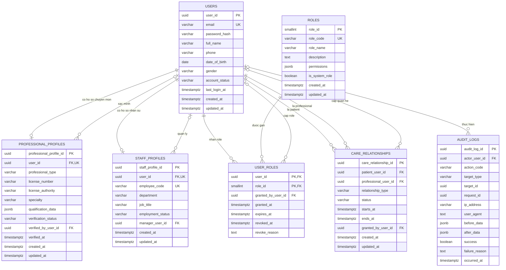
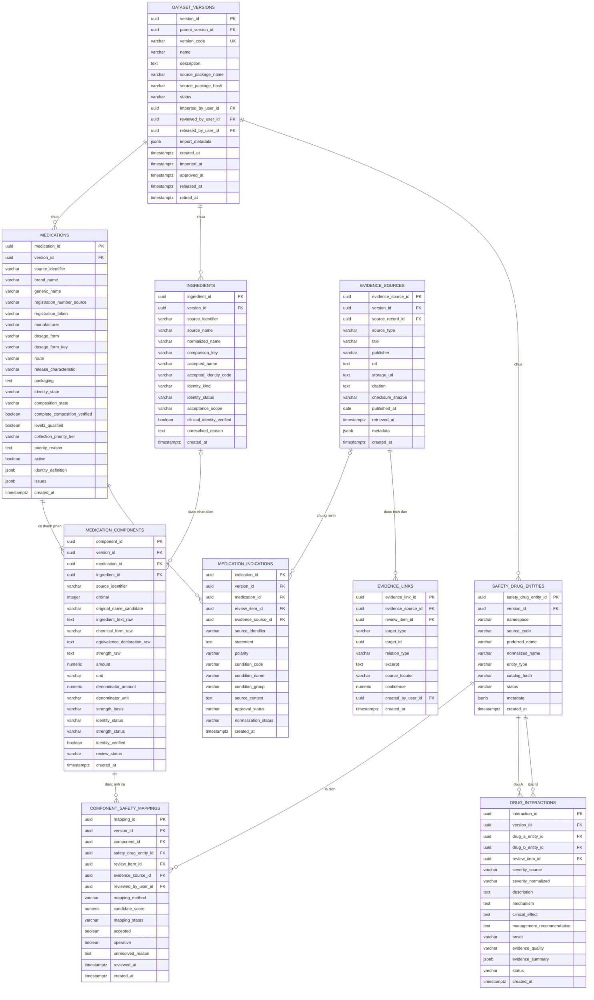
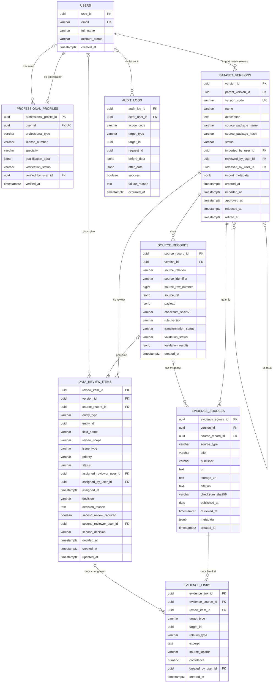
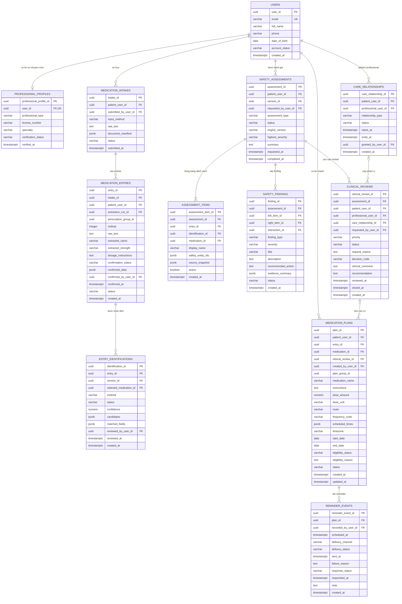
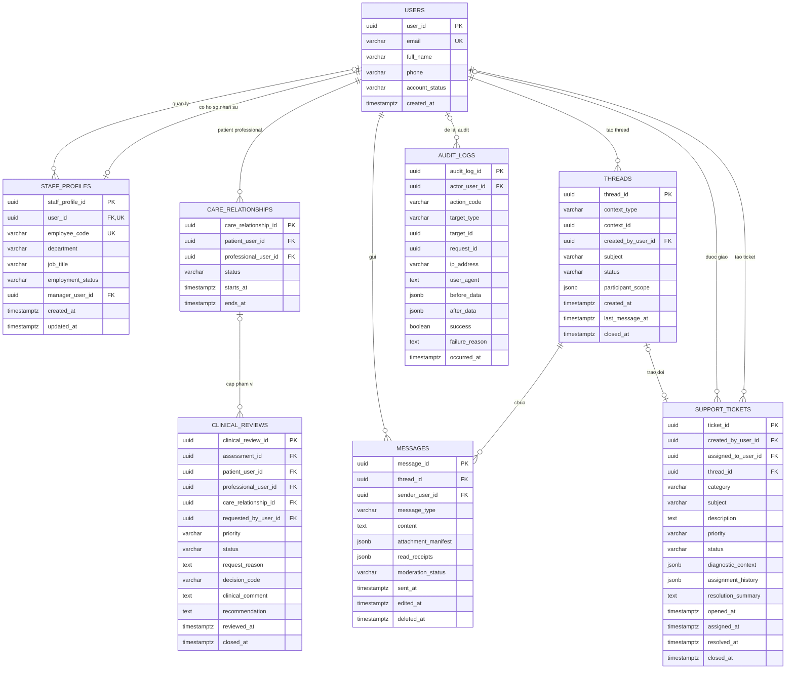

# Medication Safety Assistant - Simplified Shared Domain ERD Views 32 Tables

Các view này nhóm 32 bảng theo lĩnh vực dùng chung. Thuộc tính được giữ nhất quán với unified schema.

## Shared Domain - Users and Access Control

`ROLES.permissions` chứa permission codes cho năm role ban đầu: `patient`, `hcp`, `admin`, `technical_support`, `medical_reviewer`. Qualification nằm trong `PROFESSIONAL_PROFILES`, thông tin nhân sự nằm trong `STAFF_PROFILES`, còn quyền thực hiện công việc nằm trong `USER_ROLES`; hồ sơ không tự động cấp role.

## Shared Domain - Medication and Safety Catalog

## Shared Domain - Data Import Review and Release

## Shared Domain - Patient Medication Care

## Shared Domain - Communication and Technical Support

`THREADS` và `MESSAGES` được dùng chung cho clinical review và support nhưng quyền truy cập phải suy ra từ `context_type`, `context_id`, care relationship hoặc ticket assignment. Support không được tham gia thread clinical review nếu không có quyền HCP tương ứng.

