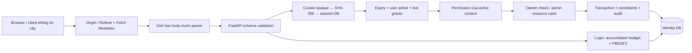

# Threat model — Authentication và RBAC

Phạm vi: API local/test của Medical Safety Assistant, 2026-11-14. Không pentest production, không brute-force mật khẩu thật, không thay đổi Core V4.

## Tài sản và ranh giới tin cậy

| Tài sản | Ranh giới / threat | Kiểm soát thực tế |
|---|---|---|
| Password | Client → API → DB | Không lưu plaintext; PBKDF2-HMAC-SHA256 600k, salt 16 byte, constant-time digest compare; dummy hash cho user không tồn tại |
| Session | Browser cookie → session table | 32 byte random token; HttpOnly, host-only, Path=/, SameSite=Lax; DB chỉ lưu SHA-256; absolute lifetime 12h |
| Role/permission | Browser role claims → server DB | Không tin localStorage/sessionStorage/header/body role claims; kiểm quyền từ DB |
| Account records | ID trong URL → chủ tài khoản | Owner-only; admin directory là endpoint riêng có permission riêng |
| Role mutation | Admin request → write transaction | Kiểm lại actor, validate target/expiry, khóa tuần tự, cùng transaction với audit |
| OCR input | Untrusted upload → multipart/parser/native library | Permission gate, body cap trước parser, giới hạn file 10MB, thư viện đã vá; cần ingress concurrency/time limits |
| Browser demo data | Người dùng trước → người dùng sau cùng tab | Dữ liệu mẫu lưu sessionStorage, không phải vùng lưu dữ liệu bệnh nhân production |
| Configuration | .env/process → app startup | Biến process ưu tiên; .env bị gitignore; production guard Secure/seed/origin/demo accounts |

## Tác nhân và kịch bản

1. Anonymous thử credential stuffing: budget DB theo account/peer, không tin X-Forwarded-For. Budget account có tradeoff: attacker có thể làm người dùng phải chờ cửa sổ 300s; cần rate limit ingress và monitoring trước public deployment.
2. Patient/support/HCP gọi admin API trực tiếp: dependencies + transaction recheck; ma trận test không qua frontend.
3. Người có hai role giả activeContext: server kiểm grant đích, token đổi sau chuyển context, không hợp nhất quyền khi authorize.
4. Người có token cũ: logout/expiry/khóa bị chặn; context đổi token; thêm quyền hủy session. Token đang còn hiệu lực và bị đánh cắp vẫn là bearer credential, không có khả năng nhận diện chủ máy thật.
5. Trang độc hại gửi request với cookie: Origin/Referer allowlist và Fetch Metadata; thiếu cả hai bị chặn. SameSite là lớp bổ sung, không thay CSRF policy. Client non-browser tự giả header không được xem là đã authenticated.
6. IDOR: đổi ID tài khoản bị 403; không có API clinical-resource hiện hữu để xác minh care relationship hoặc ownership.
7. Admin thao tác đồng thời: SQLite BEGIN IMMEDIATE; PostgreSQL advisory transaction lock bảo vệ grant invariants. Quyền admin bị lạm dụng có chủ ý không nằm ngoài quyền thiết kế; cần quy trình tổ chức và giám sát riêng.
8. Restart khôi phục quyền đã gỡ: đã sửa bootstrap chỉ cấp permission mặc định cho role mới; role hiện hữu phải được thay đổi qua migration được duyệt.

## Giới hạn

- Không chứng minh bảo mật tuyệt đối, không kiểm chứng TLS/reverse proxy production, DNS hoặc host OS.
- Chưa có MFA, idle timeout, reauthentication cho thao tác admin hay UI quản lý các phiên khác. Absolute session timeout là 12h.
- App hiện tự migration khi khởi động, nên runtime DB principal cần DDL; chưa đạt tách migrator/runtime least privilege ở production.
- OCR giữ ảnh/text trong `data/local/module1/runs`; cần retention, encryption/ACL và ownership trước dùng dữ liệu thật.
- Audit lưu trong cùng DB có thể bị DB owner sửa. Một số authorization denials/CSRF chưa được ghi audit chi tiết; chưa có SIEM/alerting.
- Lưu trữ demo cùng tab không tạo tenant isolation. Không diễn giải frontend guard thành bảo vệ dữ liệu y tế server.

## Căn cứ

[OWASP Password Storage](https://cheatsheetseries.owasp.org/cheatsheets/Password_Storage_Cheat_Sheet.html), [Session Management](https://cheatsheetseries.owasp.org/cheatsheets/Session_Management_Cheat_Sheet.html), [CSRF Prevention](https://cheatsheetseries.owasp.org/cheatsheets/Cross-Site_Request_Forgery_Prevention_Cheat_Sheet.html). PBKDF2 600k không bị coi là lỗ hổng chỉ vì không dùng Argon2id; đổi thuật toán không phải điều kiện cần để hoàn thành audit này.
